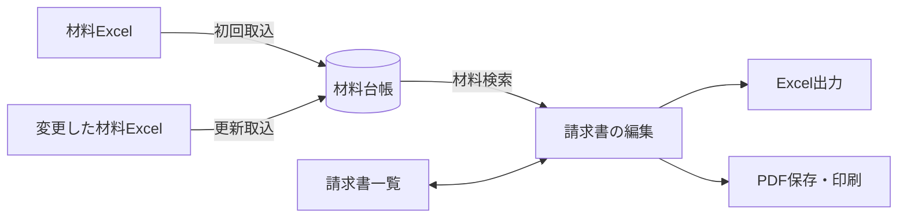

<div align="center">


# 発注書管理

**材料を探して、請求書の明細へ。**<br />
材料Excelの取込から請求書の作成・出力までを、端末の中だけで行う Windows 向けデスクトップアプリ。

<p>
  
  
  
  
  <a href="#ライセンス">
    
  </a>
</p>

<p>
  <a href="#概要">概要</a>
  ·
  <a href="#主な機能">主な機能</a>
  ·
  <a href="#使い方の流れ">使い方の流れ</a>
  ·
  <a href="#動作環境">動作環境</a>
  ·
  <a href="#セットアップと起動">セットアップ</a>
  ·
  <a href="#コマンド">コマンド</a>
  ·
  <a href="#インストール">インストール</a>
  ·
  <a href="#データの保存場所">データ</a>
  ·
  <a href="#技術構成">技術構成</a>
  ·
  <a href="#既知の制限">既知の制限</a>
  ·
  <a href="spec/README.md">仕様書</a>
</p>

</div>

<hr />

## 概要

**発注書管理**は、材料を検索して請求書の明細を作成・保存する、Windows向けのローカルデスクトップアプリです。
これまでExcelで行っていた「材料を探して請求書へコピーする」作業を置き換えます。

> [!IMPORTANT]
> **v0.1.0（開発中）** — 正式運用・配布は未承認です。

- **端末内で完結** — データはすべて端末内（SQLite）に保存します。ログイン、クラウド同期、自動更新、外部への送信はありません。
- **対応しないこと** — 単価・税額・在庫の管理には対応していません。

## 主な機能

| 機能 | できること |
| --- | --- |
| **材料取込** | 材料Excelを解析し、内容を確認してから登録。変更したExcelでの更新取込にも対応（元Excelは変更しません） |
| **材料検索** | 品名・型式・メーカー・備考の部分一致検索と、カテゴリでの絞り込み |
| **請求書編集** | 材料検索（Ctrl+F）から選んだ材料をまとめて明細に追加。明細表での入力を、出力されるExcelと同じ見た目のプレビューに同時に表示（帳票上部はプレビューへ直接入力）。自動保存 |
| **セルの書式** | Excelの［ホーム］タブと同じ要領で、揃え・太字・フォントサイズ・色などをセルごとに設定 |
| **出力** | 見本帳票と同じ形のExcel出力と、A4縦1ページのPDF保存・印刷 |
| **材料管理** | 手動での追加・編集・削除と、変更Excelの差分確認付き再取込 |
| **バックアップ・復元** | 設定画面から全データを保存・検査・復元 |

<details>
<summary><b>各機能の詳細</b></summary>

**材料取込**

- 材料Excelを解析し、内容を確認してから登録（元Excelは変更しません）。材料候補は既定で選択
- 要確認の行（型式が空欄など）や列見出しの行も、原セルを確認してチェックすれば登録できる
- 変更したExcelでの更新取込でも、品名のある要確認の行を判断できる（品名のない行とG列などの補足セルは登録しない）
- 取り込む値は前後の空白（全角・半角）を除いて登録する（原セルは元のまま確認できる。空白だけの品名・型式は空欄として要確認になる）

**材料検索**

- 品名・型式・メーカー・備考の部分一致検索
- カテゴリ絞り込み（カテゴリが100件を超える場合は、候補を名前で検索・100件ずつ切り替えて選ぶ）

**請求書編集**

- 材料検索（Ctrl+F）で追加したい材料にチェックを入れ、選んだ分をまとめて明細に追加（検索語・カテゴリ・ページを変えても選択は残る）。1件だけなら明細最終行の検索欄からも追加できる
- 自動保存、履歴からの再表示・複製・削除（1件ずつ、またはチェックで選んでまとめて。確認してから削除）
- 出力されるExcelと同じ見た目のプレビューを入力と同時に表示し、帳票上部（上部欄・ヘッダー欄・納期）はプレビューのセルへ直接入力
- 明細（品名・型式・メーカー・数量・備考）と帳票上部の欄の値は、前後の空白（全角・半角）を除いて保存する（文中の空白は残る。プレビューも除いた形で描く）

**セルの書式**

- 帳票の既定は、文字のあるセルがすべて中央揃え（縦位置はExcelの既定の下揃え）
- Excelプレビューのツールバーで、Excelの［ホーム］タブと同じ要領でセルごとに書式を付ける:
  - 横位置（左・中央・右揃え）、縦位置（上・上下中央・下揃え）
  - 太字・斜体・下線（Ctrl+B / Ctrl+I / Ctrl+U）
  - フォントサイズ（8〜16pt）、文字の色・塗りつぶしの色（18色）
  - 書式のクリア
  - 書式の変更の元に戻す・やり直し（Ctrl+Z / Ctrl+Y・Ctrl+Shift+Z、ツールバーのボタン。100回まで）
- セルはクリックのほか、ドラッグ・Shift+クリック・列や行の見出しで範囲を選べる
- 書式は入力欄のセル（上部欄・ヘッダー欄・納期と、明細のある行のチェック〜備考）にだけ付き、明細の書式は並べ替え・削除・複製で明細といっしょに動く
- プレビュー・Excel出力・PDF・印刷に同じく反映する

**出力**

- Excel出力（見本帳票と同じ列幅・罫線・書式。納期は日付「m月d日」）
- PDF保存・印刷（画面のExcelプレビューと同じ形でA4縦1ページ）
- チェック欄は凡例どおり:

  | 記号 | 意味 |
  | :---: | --- |
  | ● | 材料のみ |
  | ○ | 伝票のみ |
  | ⦿ | 材料伝票共に納品 |

- チェックは任意の項目で、選ばない明細は出力前の確認に出さず、チェック欄を空欄で出力する（選んだ記号をもう一度押すと未選択に戻る）

**材料管理**

- 手動での追加・編集（品名・型式・メーカー・数量・備考・単価は前後の空白を除いて登録）
- 削除（材料台帳から1件ずつ、またはチェックで選んでまとめて。確認してから削除。作成済みの請求書の明細と取込履歴は変わらない）
- 変更Excelの差分確認付き再取込（既定では確認が必要な行だけを表示。Excelに見当たらない材料も同じ一覧の前回の位置に並び、保持か無効化を選べる）

**バックアップ・復元**

- 設定画面から全データを保存・検査・復元

</details>

## 使い方の流れ



1. **材料を取り込む** — 材料Excelを読み込み、内容を確認して材料台帳に登録します。
2. **明細を作る** — 請求書一覧の「新規請求書」（Ctrl+N）で請求書を開き、材料検索（Ctrl+F）で材料を選んでまとめて明細に追加します。必要に応じて、明細表で数量・備考を直したり、チェック（● ○ ⦿）を選んだりします。
3. **帳票を仕上げる** — プレビューのセルに帳票上部（上部欄・ヘッダー欄・納期）を入力し、必要に応じてセルの書式を付けます。編集内容は自動保存されます。
4. **出力する** — Excel出力、PDF保存、印刷から選びます。

## 動作環境

### 利用する PC

| 項目 | 要件 |
| --- | --- |
| OS | Windows 11 x64（管理者権限は不要）。Windows 10 x64 でも動作する見込みですが未検証 |
| Microsoft Edge WebView2 ランタイム | 画面の表示に使用。Windows 11 には標準で入っています（無い場合はインストーラーが案内します） |

### 開発する PC（上記に加えて）

| 項目 | 要件 |
| --- | --- |
| Node.js | 24.19.0 以降の 24 系 |
| pnpm | 10.34.5 |
| Rust | `rust-toolchain.toml` の版（1.97.0）。[rustup](https://rustup.rs/) を入れておけば初回のビルド時に自動で用意されます |
| Visual Studio Build Tools 2022 | 「C++ によるデスクトップ開発」（MSVC のリンカーと Windows SDK。Rust のビルドに必要） |
| Inno Setup | 6.3 以降の 6 系（`pnpm make` でインストーラーを作る場合のみ） |

## セットアップと起動

PowerShellでプロジェクトのフォルダーに移動して実行します。

```powershell
pnpm install --frozen-lockfile
pnpm dev
```

- 既定のNodeが24系でない場合は、下の「Node 24を一時的に使う」の手順で起動してください。
- 依存パッケージ（npm・Rust のクレート）の初回取得にはネット接続が必要です。開発サーバーはループバックのポート5173を使います。
- 初回の `pnpm dev`・`pnpm build` は Rust のコンパイルに数分かかります（2回目以降は差分だけ）。

<details>
<summary><b>Rust と Build Tools を入れる（初回だけ）</b></summary>

```powershell
# Visual Studio Build Tools 2022（C++ によるデスクトップ開発）
winget install --id Microsoft.VisualStudio.2022.BuildTools -e --override "--quiet --wait --add Microsoft.VisualStudio.Workload.VCTools --includeRecommended"
# Rust（rustup）
winget install --id Rustlang.Rustup -e
```

Build Tools の導入には管理者権限の確認が出ることがあります。導入後は PowerShell を開き直してください。

</details>

<details>
<summary><b>Node 24を一時的に使う（端末全体の設定は変更しません）</b></summary>

1. [Node 24.19.0](https://nodejs.org/download/release/v24.19.0/) の `node-v24.19.0-win-x64.zip` を取得し、`SHASUMS256.txt` とハッシュを照合してから `%LOCALAPPDATA%\PartsOrderDev` に展開します。
2. 初回だけ、専用フォルダーにpnpmを導入します。

```powershell
$nodeDir = Join-Path $env:LOCALAPPDATA 'PartsOrderDev\node-v24.19.0-win-x64'
$pnpmDir = Join-Path $env:LOCALAPPDATA 'PartsOrderDev\pnpm-10.34.5'
& "$nodeDir\node.exe" "$nodeDir\node_modules\npm\bin\npm-cli.js" install --prefix $pnpmDir --ignore-scripts --no-audit --no-fund pnpm@10.34.5
```

3. 以降は次を貼り付けて実行します。`$task` を下の[コマンド](#コマンド)の表の `pnpm` に続く名前（例: `build`）に変えると、他の操作も同じ方法で実行できます。PATHの変更はこの処理中だけで、終了時に元へ戻ります。

```powershell
$nodeDir = Join-Path $env:LOCALAPPDATA 'PartsOrderDev\node-v24.19.0-win-x64'
$pnpmCli = Join-Path $env:LOCALAPPDATA 'PartsOrderDev\pnpm-10.34.5\node_modules\pnpm\bin\pnpm.cjs'
$task = 'dev'
$savedPath = $env:PATH
try {
    $env:PATH = "$nodeDir;$savedPath"
    & "$nodeDir\node.exe" $pnpmCli install --frozen-lockfile
    if ($LASTEXITCODE -ne 0) { throw '依存の導入に失敗しました' }
    & "$nodeDir\node.exe" $pnpmCli run $task
} finally {
    $env:PATH = $savedPath
}
```

</details>

## コマンド

**開発**

| コマンド | 内容 |
| --- | --- |
| `pnpm dev` | 開発版を起動（Vite の開発サーバー＋Tauri） |
| `pnpm lint` / `pnpm typecheck` | ESLint / TypeScript の型チェック |

**テスト**

| コマンド | 内容 |
| --- | --- |
| `pnpm test` | 単体テスト（画面側の Vitest と、アプリ本体の Rust のテスト） |
| `pnpm build:e2e` / `pnpm test:e2e` | E2Eテスト用の実行ファイルを作り（`src-tauri/target/e2e/`）、画面を操作するテストを実行 |
| `pnpm test:differential` | 移行前の TypeScript 実装と Rust 実装に同じ操作・乱数で作った入力を与え、結果を突き合わせる |
| `pnpm test:office` | 実際のLibreOffice・Excelで、出力した請求書の表示・印刷と、保存し直した材料表の取込を確認（入っているアプリだけ。ExcelはWindowsのみ） |

> [!WARNING]
> E2E 用の実行ファイルにはテスト用の操作口（ダイアログの代役・障害の注入）が入っているため、配布しないでください（`pnpm build`・`pnpm make` の実行ファイルには入りません）。

<details>
<summary><b>テストの補足（環境変数・E2E の仕組み）</b></summary>

- テストは架空データだけを使います。E2Eテストの証跡の出力先は、環境変数 `POM_E2E_EVIDENCE` で指定できます。
- `pnpm test:office`・`pnpm test:tauri` は、必要なアプリ・環境がないと該当の確認を飛ばします。環境変数 `POM_REQUIRE_OFFICE=1`（LibreOffice。Windows では Excel も）・`POM_REQUIRE_TAURI=1`（Linux・DISPLAY・ビルド済みアプリ・WebKitWebDriver）を付けると、飛ばさず失敗にします。
- `tests/unit/sheet-parity.test.ts`（`pnpm test:web` に含む）は帳票定義の TS と Rust の一致を確かめるため、Rust のハーネスを `cargo build` で作ります（cargo が必要。作り済みなら `POM_HARNESS` にパスを渡す）。
- E2Eテストは、Windows では実際のアプリ（`pnpm build:e2e` で作る E2E 用の実行ファイル）を WebView2 の DevTools 接続で操作します。WebView2 のない環境（Linux など）では、同じ画面とアプリ本体を中継（`pom-bridge`）で動かし、Chromium で操作します（`POM_E2E_TARGET=bridge|webview2` で切り替え）。
- Windows の E2E 用の実行ファイルは、ウィンドウを画面の外に置き、フォーカスを取りません（開発起動を確かめる `tests/e2e/dev.spec.ts` は E2E 用の実行ファイルを使わないため対象外）。テストの様子を画面で見るときは、環境変数 `POM_E2E_SHOW=1` を設定して実行します。

</details>

**ビルド・配布**

| コマンド | 内容 |
| --- | --- |
| `pnpm build` | Windows x64 の実行ファイルを生成（`src-tauri/target/release/parts-order-manager.exe`） |
| `pnpm make` | 実行ファイルとインストーラー（未署名）を生成（インストーラーは `out/make/inno-setup/x64/`） |

**メンテナンス**

| コマンド | 内容 |
| --- | --- |
| `pnpm notices` | 第三者ライセンス表記（THIRD-PARTY-NOTICES.txt）を作り直す（依存を更新したとき） |
| `pnpm icons` | `assets/icon` の SVG からアイコンを作り直す |

### インストーラーの作成

インストーラーの作成には [Inno Setup 6](https://jrsoftware.org/isinfo.php) が必要です。次のコマンドで導入できます（管理者権限は不要）。

```powershell
winget install --id JRSoftware.InnoSetup -e --scope user
```

- 標準以外の場所に入れた場合は、環境変数 `PARTS_ORDER_ISCC` に `ISCC.exe` の絶対パスを指定してください。
- Inno Setup は無料で使えますが、営利目的で使う場合は有償ライセンスの購入が求められています（必須ではありません。条件は[公式サイト](https://jrsoftware.org/isorder.php)を参照）。

## インストール

`PartsOrderManager-<バージョン>-Setup.exe` を実行すると、次の順に確認しながらインストールします。

1. **インストールモード** — 現在のユーザー用（既定・管理者権限は不要）か、すべてのユーザー用（管理者権限が必要）
2. **インストール先** — 既定は `%LOCALAPPDATA%\Programs\発注書管理`（すべてのユーザー用は `C:\Program Files\発注書管理`）
3. **ショートカット** — デスクトップにショートカットを作るか（既定はオン）
4. **起動** — 完了後にアプリを起動するか

スタートメニューには常に登録します。アンインストールはWindowsの「設定 > アプリ」から行います。アンインストールしても、データ（[データの保存場所](#データの保存場所)の保存先）は削除しません。

> [!NOTE]
> **Electron 版（〜v0.1.0）からの更新** — 新しいインストーラーを上書きで実行します（同じインストール先・ショートカットを使い、Electron 版の実行時ファイルは削除します）。データの保存場所は同じなので、DB・バックアップの記録はそのまま引き継がれます。

## データの保存場所

| 環境 | 保存先 |
| --- | --- |
| 本番 | アプリの「設定」画面に表示される場所の `database/app.sqlite` |
| 開発 | `%APPDATA%\parts-order-manager-development\database\app.sqlite` |
| 起動時に `--user-data-dir=<フォルダー>` を指定した場合 | そのフォルダー（検証用） |

画面（WebView2）のキャッシュなどは保存場所の `EBWebView` フォルダーに置きます。Electron 版が保存場所に作った `Cache`・`GPUCache`・`Local Storage` などのフォルダーは使わなくなりますが、自動では削除しません（不要なら手動で削除できます。`database` フォルダーとバックアップは削除しないでください）。

> [!CAUTION]
> DBファイルを直接コピーして復元しないでください。バックアップと復元は、必ず「設定」画面の機能を使ってください。

> [!WARNING]
> DB・バックアップ・出力した帳票は暗号化されていません。保管先とアクセスできる人に注意してください。

## 技術構成

| 領域 | 技術 |
| --- | --- |
| アプリの土台 | Tauri 2（Microsoft Edge WebView2） |
| アプリ本体 | Rust |
| 画面 | React 19 / TypeScript / Vite / Tailwind CSS 4 |
| データ | SQLite（rusqlite。SQLite を同梱） |

### フォルダー構成

```text
src/
  renderer/  画面（React）。tauri-api.ts が window.appApi（旧 preload と同じ形）を用意する
  shared/    画面と本体の間の型とチャネル定義
src-tauri/
  core/      業務処理・DB・Excel入出力・印刷用HTML・バックアップ（pom-core。画面やOSに依存しない）
  src/       ウィンドウ・ダイアログ・終了確認・印刷プレビュー・PDF・二重起動防止（Tauri の本体）
tests/       unit（Vitest） / e2e（Playwright） / differential（旧実装との突き合わせ） / office（LibreOffice・Excel）
```

### セキュリティ

- 画面からアプリ本体へは、`ipc` コマンド1つ（チャネル名と引数）だけを呼べます。権限設定（`src-tauri/capabilities/main.json`）でメインウィンドウのアプリ内ページに限り、ほかの Tauri の機能（ファイル・ウィンドウ操作など）は許可していません。
- CSP でスクリプト・通信先をアプリ自身に限り、アプリのページ以外への移動・新しいウィンドウ・ダウンロード・権限要求（位置情報など）は拒否します。印刷プレビューはスクリプトを無効にした別ウィンドウです。
- ドロップしたファイルの場所は WebView2 から本体が直接受け取り、画面からは任意のパスを指定できません。

### 旧 Electron 版からの移行

旧 Electron 版（Node.js の Main プロセス）からの移行で、業務処理は TypeScript から Rust に置き換えました。チャネル名・引数・応答・エラー文言・DB の形式・バックアップ（.pombak）の形式は旧版と同じです。旧版の単体テストはすべて Rust のテストに移植し、旧実装と Rust 実装の結果を突き合わせる差分テスト（`pnpm test:differential`）で同じ動作であることを確かめています。

### 移行後の仕様変更

旧版から変えた点・足した機能です。各項目を開くと、詳細（チャネル・DB・バックアップへの影響、差分テストでの扱いなど）を確認できます。

<details>
<summary><b>取込の判断とカテゴリの扱い</b></summary>

移行後に変えた仕様:

- 初回取込の確定（`imports:apply`）で、品名のある要確認行・列見出しの行も選んで登録できます（旧版は材料候補だけ）。品名のある要確認行が残っていれば「未反映の候補を再確認」も開けます。
- 更新取込の確定（`reimport:apply`）でも、品名のある要確認行を「新規材料として追加」「差分を反映」にできます（旧版は保留だけ）。
- 更新取込の応答（`reimport:*`）には、新Excelのどの行からも候補に挙がらない有効な材料の一覧 `missingIds` を足しました。
- 初回取込・更新取込の確認応答には、確認中でない記録から再確認できない理由 `resumeBlocked`（再確認できるときは `null`）を足し、画面は再確認できない記録にボタンを出さずに理由を示します。取り消した記録の再確認ボタンは「最初から確認し直す」です。
- 初回取込を確定した後に内容の異なるExcelを初回取込したときのエラー文言は、「変更したExcelで更新」へ案内する文言に変えました。
- カテゴリの総数で材料の画面・検索を止めないようにしました（旧版は256件を超えると材料の新規作成・編集の画面を、1000件を超えると材料検索を開けませんでした）。材料の画面（`master:get`）のカテゴリは並び順（並び順の値・ID）の先頭100件とし、総数 `categoryTotal` を足しました。材料検索（`materials:search`）の応答のカテゴリは先頭の1000件までとし、同じく総数 `categoryTotal` を足しました。残りの候補は新しいチャネル `materials:categories`（検索語・件数の数え方・開始位置を指定し、100件ずつ返す）で検索・ページ取得します。カテゴリの作成数の上限は設けていません。
- 材料の画面のカテゴリの並び順は、旧版の作成順から、材料検索と同じ並び順の値・ID の順に変わりました（新規作成の既定のカテゴリは、その先頭のカテゴリです）。
- 差分テストは、旧版にない `missingIds`・`resumeBlocked`・`categoryTotal` を突き合わせから外し、材料の画面のカテゴリを名前順にそろえたうえで、これらの変更に当たらない操作で突き合わせています。

</details>

<details>
<summary><b>セルの書式</b></summary>

- セルの書式を足しました。帳票の応答（`documents:open`・`documents:duplicate`）の下書き `draft` と明細に、書式 `formats`（書式があるときだけ）を足し、保存（`documents:save`）でも省略できるキーとして受け付けます。
- DBのスキーマは変えず、書式は `documents.header` の JSON に `formats`（`header`: 帳票上部の欄、`lines`: 明細IDごと）として保存します（書式のない帳票は従来と同じ JSON・同じExcel・同じ印刷HTML。旧版でもDB・バックアップを開け、書式は無視されます）。
- Excelの styles.xml は、書式を付けたセルの組合せごとに xf を既定の17個の後ろへ足し、その組合せを XML のコメントに記録します（既存ファイルへの上書き前に、記録から作り直して一致するかでこのアプリの出力と確かめるため）。
- 書式を付けた帳票の印刷HTMLは、書式用の固定クラスを足したスタイルとそのハッシュのCSPを使います。
- 差分テストは書式のない帳票で突き合わせています（旧版にない書式は対象外）。

</details>

<details>
<summary><b>請求書の削除</b>（<code>documents:delete</code>）</summary>

- 請求書の削除を足しました（新しいチャネル `documents:delete`。引数は請求書の ID の配列1つで、1〜100件・重複なし。応答は `{ deleted: 削除した数 }`）。
- 明細と請求書を1つのトランザクションで削除し、すべて削除するか、何も削除しません。見つからない ID は削除済みとして扱います（応答が届かなかった後の再送を失敗にしないため）。
- 削除した請求書から複製した請求書は残し、複製元の参照（`duplicated_from_id`）だけを外します（内容・版・更新日時は変えません。一覧の「複製」の表示は消えます）。
- 開いている請求書を削除したときは、編集セッションを閉じます。削除した請求書は、出力の記録（`ui-meta.json`）からも消します。
- DBのスキーマは変えていません（旧版でもDB・バックアップを開け、削除した請求書は一覧に出ません）。旧版にない機能のため、差分テストの対象外です。

</details>

<details>
<summary><b>材料の削除</b>（<code>master:delete</code>・DBのスキーマ4版）</summary>

- 材料の削除を足しました（新しいチャネル `master:delete`。引数は材料の ID の配列1つで、1〜100件・重複なし。応答は `{ deleted: 削除した数 }`）。
- 材料は取込の判断履歴（変更できない記録）・作成の受領記録・請求書の明細から参照されるため、行は消さずに、DBのスキーマを4版にして材料に足した列 `deleted_at` に削除した日時を記録します（版を上げ、更新日時も削除した日時にします）。
- 1つの文で更新するため、すべて削除するか、何も削除しません。削除済み・見つからない ID は削除済みとして扱います（応答が届かなかった後の再送を失敗にしないため）。
- 削除した材料は、材料検索（`materials:search`）・カテゴリの件数と材料の総数（`materials:categories`・材料検索の応答のカテゴリ）・材料の画面（`master:get` は「材料が見つかりません。」、`master:save` は競合）・明細への追加（`documents:add-line`）・更新取込の確認（材料・候補・Excelに見当たらない材料。削除した材料に対応していた行は「対応なし」）から外れ、バックアップの検査の件数にも数えません。
- 作成済みの請求書の明細は値のまま残り、開いて保存できます。
- 更新取込で、シートの材料をすべて削除した後にその行を新規材料として追加すると、削除した材料のカテゴリに入れます（同じ名前のカテゴリを増やさないため）。
- 確認中の更新取込は、対象の材料を削除すると古い確認になり、再確認を求めます。
- バックアップ（.pombak）の目録は `schemaVersion` が4、`migrationHashes` が4つになります。検査・復元は、3版（材料の削除を足す前の版・旧版）と4版のバックアップを受け付けます（目録の版・移行のチェックサムとDBの版・構造が一致すること。3版のDBは、復元した後の起動で4版へ移行します）。4版のDB・バックアップは、材料の削除を足す前の版と旧版では開けません。
- 差分テストは、新実装のDBの `deleted_at` 列（削除していない材料の空の値）と、4版の移行履歴を突き合わせから外しています（材料の削除そのものは旧版にない機能のため対象外）。

</details>

<details>
<summary><b>帳票の既定の揃えと、登録する値の空白の扱い</b>（2026年10月15日）</summary>

- 帳票の既定の揃えと、登録する値の空白の扱いを変えました（利用者の指示、2026年10月15日）。
- 文字のあるセルの横位置は、見本の左揃え・字下げ（品名・型式・備考・チェック・上部欄・凡例）をやめ、すべて中央揃えを既定にしました（縦位置はExcelの既定の下揃えのまま。セルごとの書式で変えられます）。
- プレビュー・Excel出力（既定17個の xf の alignment）・印刷HTMLに同じく反映し、中央揃えの文字は左右に続く空欄へ同じ幅だけ（短い側の幅まで）はみ出します（印刷HTMLは、列と左右に続く空欄の数ごとの固定クラス `.m列-左-右` で位置と幅を決めます）。
- 帳票の形式 `excel-v1` は変えていません（既定の書式だけの変更で、保存した請求書はそのまま開けて出力できます）が、以前に出力した xlsx は既定の xf が違うため上書きできません。
- バックアップ（.pombak）の目録には既定の styles.xml を埋めて検査で照合しているため、以前の版で作ったバックアップは旧既定の文字列（`exports::LEGACY_STYLES`）も受け付けて、今までどおり検査・復元できます。
- 登録する値は、材料の6項目（手動の保存・初回取込・更新取込。DBへ書く `materials::create`・`update` で除きます。取込の行の値 `values` は原セルの表示文字列から前後の空白を除いたもので、原セル `cells` は元のままです）と、請求書の明細の文字の欄（品名・型式・メーカー・数量・備考）・帳票上部の欄（上部欄・ヘッダー欄・納期。`documents:save` で除きます）について、前後の空白（JavaScript の `trim` と同じ全角・半角の空白）を除いて保存します（管理用タイトルは除きません）。
- 画面のプレビューと出力前の確認（納期の形式）も同じ値で判定します。
- 差分テストは、旧版が前後の空白を残すため、両方の応答と DB の文字列の前後の空白を除いてから突き合わせ、旧版の固定の書式と印刷HTMLを比べる部分は対象外にしました（帳票の既定が違うため）。

</details>

<details>
<summary><b>Excel・PDF・バックアップの新規保存の確定方法</b></summary>

- Excel・PDF・バックアップの新規保存の確定方法を変えました。
- 旧版・移行直後は完成した一時ファイルへのハードリンクで確定していたため、ハードリンクを作れない exFAT・FAT32（多くのUSBメモリ）には新規保存できませんでした。
- Windows では、同じフォルダーの一時ファイルを、保存先に同名のファイルがない場合に限って移動して確定します（`MoveFileExW` を置換・別ドライブへのコピーなしで呼ぶ）。確認の後に同名のファイルが現れた場合は上書きせずに失敗します。
- Windows 以外（開発・テスト用）は従来どおりハードリンクで確定します。

</details>

<details>
<summary><b>明細のチェックを任意の項目に</b>（2026年10月16日）</summary>

- 明細のチェックを任意の項目にしました（利用者の指示、2026年10月16日）。
- それまでは、チェックを選んでいない明細（`deliveryState` が `unknown`・`markOutput` が `unresolved`）があると、Excel出力・印刷プレビュー（`documents:export-excel`・`documents:print-preview`）を `blocked` で止め、請求書一覧（`documents:list`）の確認の件数 `issueCount` にも数えていました。
- 今は止めずにチェック欄を空欄で出力し、出力前の確認・プレビューの印・一覧の件数にも出しません。止めるのは、記号を決める前に保存した「共に納品」（`both`・`unresolved`）、状態と記号の不一致、規則の版の違いだけです。
- DB と保存の形式は変えていません（未選択の値もそのまま保存します）。
- 差分テストは、旧版が未選択の明細で出力を止めるため、出力を止める請求書の明細にはチェックを選んでから突き合わせます。

</details>

## 既知の制限

### インストール・動作

- インストーラーは未署名のため、実行時にWindowsの警告（SmartScreen）が出ることがあります。Tauri 版のインストール・アンインストール・Electron 版からの更新は、実機での確認がまだです。
- メインウィンドウを最小化している間は、画面（WebView2）のメモリ使用を抑えるよう WebView2 に指示します（Microsoft 推奨の MemoryUsageTargetLevel。自動保存・終了確認は止まりません）。メモリの一部がディスクへ退避されることがあり、元に戻した直後の操作がわずかに遅くなる場合があります。実機での削減量は未計測です。

### 出力・印刷

- 47行を超える明細は、業務ルールが未確定のため出力を止めます。記号を決める前の版で保存した「材料・伝票とも納品」の明細（記号未確定）も、⦿ を選び直すまで出力を止めます。
- 「材料伝票共に納品」の記号を決める前に保存した明細は、記号（⦿）を選び直すまで出力を止めます。
- 実際のExcelでの表示・印刷との完全一致は未検証です。画面のプレビューは100%・96dpi相当の寸法で描くため、Windowsの表示倍率やフォントの違いで文字のはみ出し方がわずかに変わることがあります。
- PDF保存・印刷は印刷範囲をA4縦1ページに収めるため約64%に縮小します。出力するExcelファイルも「1ページに収める」印刷設定にしています（見本の68%指定のままだと、Excelでは最終行付近が、LibreOfficeではG列も別ページに分かれるため）。印刷範囲は罫線のあるA〜G列（見本にある空欄のH列は含めません）で、PDF・印刷・Excelとも用紙の左右中央に置きます。セルに入りきらない文字はExcelと同じく途中で切れます。
- 印刷（プリンターを選んで印刷）は、Windows 標準の印刷ダイアログでプリンター・部数・両面などを選び、WebView2 の印刷機能で印刷します。Electron 版の印刷ダイアログと見た目・選べる項目が少し異なります。
- 帳票形式の変更前に出力したxlsxへの上書き保存はできません（帳票の既定の揃えを中央に変えた版より前に出力したファイルも同じ）。別の名前で出力してください。
- exFAT・FAT32 の保存先（USBメモリなど）への新規保存は、実際の媒体での確認がまだです。保存中の電源断・取り外しに対する耐性は、保存先のファイルシステムによって異なり、NTFS と同じにはなりません。

### セルの書式

- セルの書式は Excel の一部の機能だけです（セルの結合・罫線・折り返し・縮小して全体を表示・フォントの種類・数値の表示形式・条件付き書式は未対応）。フォントサイズは帳票の行の高さに収まる 8〜16pt、色は決まった18色から選びます。
- 中央揃え（帳票の既定）の文字は、左右に続く空欄へ同じ幅だけ（短い側の空欄の幅まで）はみ出します。片側の隣が埋まっているときはセルの幅で切れます（Excelでは空いている側へだけはみ出します）。左揃えの文字は右の空欄へ、右揃えの文字は左の空欄へ、Excelと同じくはみ出します。
- 書式の範囲選択はマウス（ドラッグ・Shift+クリック・列や行の見出し）だけです。キーボードでは、明細表や帳票上部の欄にフォーカスしたセルへ書式を付けます。
- 書式の元に戻す・やり直し:
  - Ctrl+Z・Ctrl+Y は書式の変更を戻す・やり直します。文字の入力欄で押したときは、その欄の文字の入力と書式の変更のうち新しい方から順に戻し、やり直しは戻した順の逆に行います（文字は入力欄の標準の取り消し・やり直しで、ほかの欄の文字は戻しません。ツールバーのボタンは常に書式を戻す・やり直す）。
  - 続けて入力した文字をまとめて戻す単位は WebView2 の入力欄の動きに従うため、書式との順番が1段ずれることがあります。
  - 「入力欄に色を付ける」などの表示の切り替えでは履歴は変わりません。明細の追加・削除・並べ替えは元に戻せません。
  - 書式の履歴は請求書を開いている間だけで、開き直すと消えます。文字を入力すると、書式のやり直しはできなくなります。

### データ・取込

- 削除した請求書は元に戻せません（ごみ箱はありません）。戻すには、削除前に作ったバックアップから復元します（復元は全データを置き換えます）。
- 削除した材料も元に戻せません（戻し方は請求書と同じくバックアップからの復元）。削除した材料の行は、取込履歴から参照されるためDBとバックアップに残ります（画面には出ません）。
- 材料の削除を足した版（DBのスキーマ4版）で一度起動すると、それより前の版ではDBを開けません（起動時に、移行前のDBの複製を保存場所の `database/migration-backups` に残します）。
- 前後の空白は保存のときに除くため、入力欄には入力したままの文字が残り、プレビューは除いた形で描きます（開き直すと入力欄も除いた形になります）。この版より前に登録した材料・保存した請求書の値は、保存し直す（請求書は開いて保存、材料は編集して保存）まで前後の空白が残ります。材料台帳の「前回確認済み取込値」との比較では、取込の値だけ空白を除いた形になるため、以前に取り込んだ材料は空白の分だけ「変更あり」と出ることがあります。
- LibreOfficeで材料表を作る・直す場合は、.xlsx形式で保存してください（.odsは取り込めません）。

## ライセンス

UNLICENSED（非公開）。実行ファイルに含まれるオープンソースソフトウェアのライセンスは [THIRD-PARTY-NOTICES.txt](THIRD-PARTY-NOTICES.txt) を参照してください（`pnpm notices` で作り直せます）。
